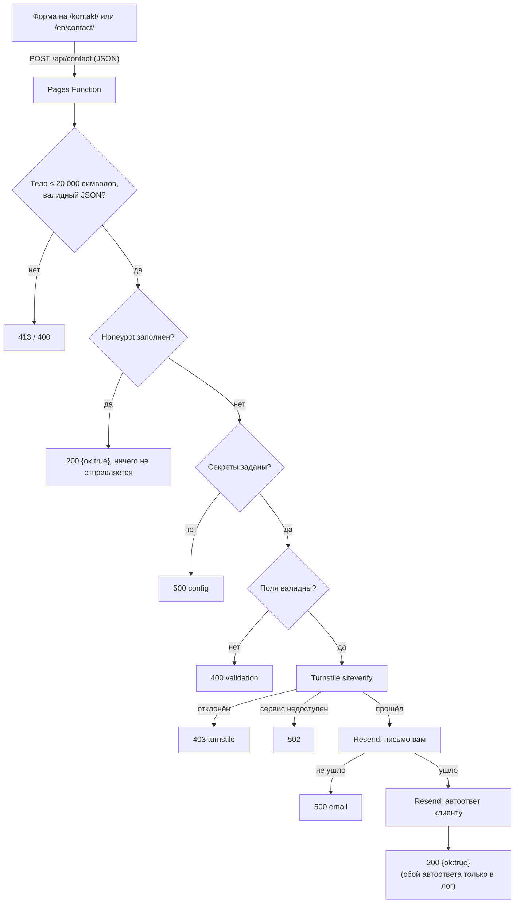

# Контактная форма: Pages Function + Resend

Как заявка с сайта попадает к вам. Форма отправляет JSON на `/api/contact` на том же домене. Это Cloudflare Pages Function (`functions/api/contact.ts`): она проверяет данные и токен Turnstile на сервере и отправляет два письма через Resend. Сайт при этом остаётся статическим.

Заявки **нигде не хранятся**, кроме вашей почты. Если нужна история, её надо вести отдельно (например, пересылкой писем в таблицу).

## Схема



Порядок проверок такой: размер и JSON, honeypot, секреты, валидация, Turnstile, письмо вам, автоответ. Токен Turnstile **проверяется только на сервере**, секрет в браузер не попадает.

## Запрос

`POST /api/contact`, `Content-Type: application/json`:

| Поле             | Значение                                                                         |
| ---------------- | -------------------------------------------------------------------------------- |
| `name`           | строка, 2–100 символов                                                           |
| `email`          | корректный e-mail, до 254 символов                                               |
| `projectType`    | id услуги: латиница, цифры и дефис, до 40 символов (например `landing`, `other`) |
| `budget`         | `lt-300`, `300-700`, `700-1500`, `gt-1500` или `unsure`                          |
| `message`        | строка, 10–5000 символов                                                         |
| `lang`           | `sk` или `en` (по нему выбирается язык автоответа)                               |
| `consent`        | строго `true`                                                                    |
| `website`        | honeypot: у людей всегда пустая                                                  |
| `turnstileToken` | токен виджета Turnstile                                                          |

## Ответы

| Код   | Тело                                                      | Когда                                            |
| ----- | --------------------------------------------------------- | ------------------------------------------------ |
| `200` | `{ "ok": true }`                                          | письма отправлены, либо заполнен honeypot        |
| `400` | `{ "ok": false, "error": "validation", "fields": [...] }` | поля неверны, нет токена или `consent` не `true` |
| `400` | `{ "ok": false, "error": "invalid_body" }`                | тело не JSON-объект                              |
| `403` | `{ "ok": false, "error": "turnstile" }`                   | токен Turnstile не принят                        |
| `413` | `{ "ok": false, "error": "too_large" }`                   | тело больше 20 000 символов                      |
| `500` | `{ "ok": false, "error": "email" }`                       | письмо вам не ушло                               |
| `500` | `{ "ok": false, "error": "config" }`                      | не заданы секреты функции                        |
| `502` | `{ "ok": false, "error": "turnstile_unavailable" }`       | не удалось связаться с Turnstile                 |

Если не ушёл **только автоответ**, клиент всё равно получает `200` (заявка у вас), а ошибка пишется в лог без данных клиента.

## Письма

- **Вам** (`CONTACT_TO`): тема `Nový dopyt: {имя} — {тип проекта}`, все поля в простой HTML-таблице, `Reply-To` равен e-mail клиента, поэтому можно отвечать прямо из почты. Письмо всегда на словацком.
- **Клиенту** (на языке формы): благодарность, обещание ответить в течение 1 рабочего дня, ссылка на запись `https://cal.com/daniil-biiakov/30min`, подпись «Daniil Biiakov — web & automation». `Reply-To` равен `CONTACT_TO`.
- Весь текст, который ввёл посетитель, экранируется в HTML, а в теме письма переводы строк вырезаются.

## Переменные

| Имя                         | Где задаётся                                          | Секрет | Назначение                                                                     |
| --------------------------- | ----------------------------------------------------- | ------ | ------------------------------------------------------------------------------ |
| `PUBLIC_TURNSTILE_SITE_KEY` | `.env` локально, переменная сборки в Cloudflare Pages | нет    | публичный ключ виджета Turnstile                                               |
| `TURNSTILE_SECRET_KEY`      | `.dev.vars` локально, Secret в Cloudflare Pages       | да     | секретный ключ того же виджета                                                 |
| `RESEND_API_KEY`            | `.dev.vars`, Secret                                   | да     | ключ API Resend                                                                |
| `CONTACT_TO`                | `.dev.vars`, Secret или Variable                      | нет    | куда доставлять заявки                                                         |
| `CONTACT_FROM`              | `.dev.vars`, Secret или Variable                      | нет    | отправитель обоих писем, например `Daniil Biiakov <kontakt@daniilbiiakov.com>` |

`PUBLIC_TURNSTILE_SITE_KEY` читается **при сборке** и вшивается в страницу, поэтому после его изменения нужен новый деплой. Шаблоны: `.env.example` и `.dev.vars.example`.

## Настройка Resend

1. Создайте аккаунт на resend.com.
2. **Domains → Add Domain**: добавьте `daniilbiiakov.com` и пропишите в DNS записи, которые покажет Resend (SPF и DKIM; по желанию DMARC). Пока домен не подтверждён, Resend отклоняет письма с адресом отправителя на этом домене.
3. **API Keys → Create API Key** с правом отправки. Ключ показывается один раз.
4. `CONTACT_FROM` должен быть адресом на подтверждённом домене.

## Настройка Turnstile

В Cloudflare: **Turnstile → Add widget**, домен `daniilbiiakov.com`. Получите **site key** (публичный) и **secret key** (секретный).

## Секреты в Cloudflare Pages

Через дашборд: **Workers & Pages → ваш проект → Settings → Variables and Secrets → Add**. Для `RESEND_API_KEY` и `TURNSTILE_SECRET_KEY` выберите тип **Secret** (Encrypt). `PUBLIC_TURNSTILE_SITE_KEY` добавьте как обычную переменную: она нужна сборке. Задайте значения отдельно для **Production** и **Preview**, если проверяете превью-деплои.

Через консоль:

```bash
npx wrangler pages secret put RESEND_API_KEY --project-name <имя-проекта>
npx wrangler pages secret put TURNSTILE_SECRET_KEY --project-name <имя-проекта>
npx wrangler pages secret put CONTACT_TO --project-name <имя-проекта>
npx wrangler pages secret put CONTACT_FROM --project-name <имя-проекта>
```

После добавления или изменения секретов нужен **новый деплой**, иначе функция работает со старыми значениями.

Логи функции смотрите в дашборде проекта (раздел Functions, Real-time Logs). В них нет текста сообщений и адресов клиентов, только коды и причина отказа Resend.

## Локальная разработка

`npm run dev` запускает только сайт: функции в нём **не работают**, форма получит 404. Для формы:

```bash
cp .env.example .env              # PUBLIC_TURNSTILE_SITE_KEY (тестовый ключ уже подставлен)
cp .dev.vars.example .dev.vars    # секреты функции
npm run dev:full                  # сборка и wrangler pages dev dist, адрес http://localhost:8788
```

Тестовые ключи Cloudflare работают на localhost и на любом домене:

| Ключ                                         | Поведение                             |
| -------------------------------------------- | ------------------------------------- |
| site `1x00000000000000000000AA`              | виджет всегда проходит                |
| site `2x00000000000000000000AB`              | виджет всегда блокирует               |
| site `3x00000000000000000000FF`              | принудительная интерактивная проверка |
| secret `1x0000000000000000000000000000000AA` | сервер принимает тестовый токен       |
| secret `2x0000000000000000000000000000000AA` | сервер всегда отклоняет               |

Боевой secret тестовый токен отклонит, а тестовый secret не годится для боевого site key.

## Как протестировать

Функцию можно проверить без браузера (в одном терминале `npm run dev:full`, в другом):

```bash
URL=http://localhost:8788/api/contact
H='Content-Type: application/json'

# 1. Без токена: 400
curl -i -X POST $URL -H "$H" -d '{"name":"Jana Test","email":"jana@example.com","projectType":"landing","budget":"unsure","message":"Test správy z formulára.","lang":"sk","consent":true,"website":""}'

# 2. Honeypot заполнен: 200, ничего не отправляется
curl -i -X POST $URL -H "$H" -d '{"name":"Bot","email":"bot@example.com","projectType":"landing","budget":"unsure","message":"Spam spam spam.","lang":"sk","consent":true,"website":"spam"}'

# 3. С тестовым токеном и тестовым secret: проходит Turnstile, дальше зависит от ключа Resend
curl -i -X POST $URL -H "$H" -d '{"name":"Jana Test","email":"jana@example.com","projectType":"landing","budget":"unsure","message":"Test správy z formulára.","lang":"sk","consent":true,"website":"","turnstileToken":"XXXX.DUMMY.TOKEN.XXXX"}'
```

Что ожидать в третьем запросе: с настоящим `RESEND_API_KEY` и подтверждённым доменом `200` и два письма; с заведомо неверным ключом `500 {"error":"email"}` (значит, Turnstile пройден, а Resend отказал). Если подставить тестовый secret «всегда отклоняет» (`2x…AA`), вместо этого будет `403`.

Автоматические проверки логики (без сети) запускает `npm test`: honeypot, валидация, Turnstile, оба письма, сбой автоответа.

## Перед запуском

- [ ] Домен подтверждён в Resend, `CONTACT_FROM` на нём, ключ API создан.
- [ ] Виджет Turnstile создан на `daniilbiiakov.com`; боевой site key задан как `PUBLIC_TURNSTILE_SITE_KEY` для сборки.
- [ ] `RESEND_API_KEY`, `TURNSTILE_SECRET_KEY`, `CONTACT_TO`, `CONTACT_FROM` заданы в Cloudflare Pages, затем сделан новый деплой.
- [ ] Реальная заявка с боевого сайта дошла вам, а автоответ клиенту (проверьте на втором своём адресе) пришёл на нужном языке.
- [ ] В политике приватности заполнены `[TODO]` (адрес, срок хранения, почтовый провайдер) и текст проверен.
