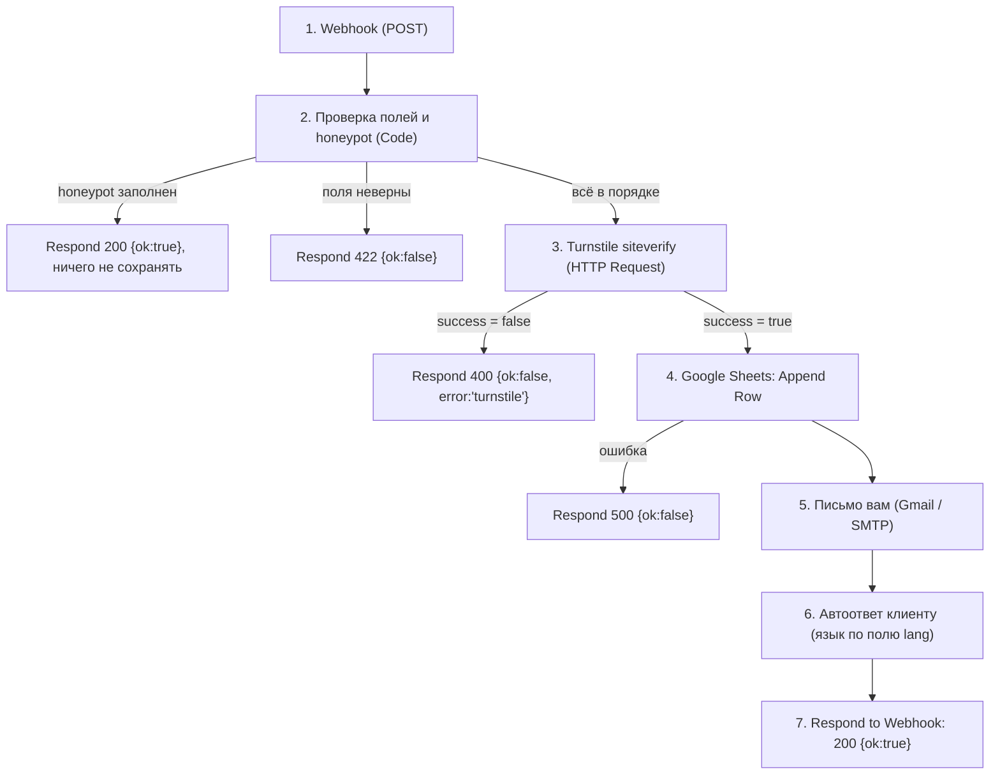

# Форма заявки → n8n

Как заявка с сайта попадает к вам. Страница контакта отправляет JSON на webhook n8n, n8n проверяет токен Cloudflare Turnstile, пишет строку в Google Sheets, присылает вам письмо, отправляет автоответ клиенту на его языке и отвечает сайту `200`.

## Схема



Порядок шагов 3–7 соответствует заявленному: **Webhook → проверка Turnstile → строка в таблицу → письмо вам → автоответ → ответ 200**. Шаг 2 стоит перед Turnstile, потому что проверка полей ничего не стоит и отсекает мусор до обращения к Cloudflare.

## Что присылает сайт

`POST` с `Content-Type: application/json`. Тело:

| Поле             | Тип             | Значение                                                                                                         |
| ---------------- | --------------- | ---------------------------------------------------------------------------------------------------------------- |
| `name`           | строка, 2–100   | имя                                                                                                              |
| `email`          | строка, до 254  | e-mail клиента                                                                                                   |
| `projectType`    | строка          | `landing`, `business-site`, `booking-app`, `automation` или `other` (id услуг из `src/content/services` и «Iné») |
| `budget`         | строка          | `lt-300`, `300-700`, `700-1500`, `gt-1500` или `unsure`                                                          |
| `message`        | строка, 10–2000 | сообщение                                                                                                        |
| `consent`        | boolean         | всегда `true` (без согласия форма не отправляется)                                                               |
| `lang`           | `sk` или `en`   | язык страницы, по нему выбирается автоответ                                                                      |
| `page`           | строка          | путь страницы, с которой отправили, например `/kontakt/`                                                         |
| `turnstileToken` | строка          | одноразовый токен Turnstile, проверяется **здесь**, а не на сайте                                                |
| `website`        | строка          | honeypot. У реальных людей всегда пустая                                                                         |

Сайт считает успехом любой ответ `2xx`. Коды `400` и `403` показываются клиенту как «не прошла проверка от спама», остальные ошибки как общий сбой с предложением написать на e-mail. Ответ n8n должен прийти быстрее 15 секунд, иначе сайт сочтёт запрос зависшим.

## Узлы

### 1. Webhook

- HTTP Method: `POST`. Path: например `portfolio-contact`.
- **Respond: Using 'Respond to Webhook' Node** (ответ уйдёт после всех шагов).
- Options → **Allowed Origins (CORS)**: `https://daniilbiiakov.com`. Для локальной проверки временно добавьте `http://localhost:4321`.
- Для сайта нужен **Production URL** (появляется после публикации workflow), а не Test URL. Он идёт в `PUBLIC_N8N_WEBHOOK_URL`.

### 2. Проверка полей и honeypot (Code, JavaScript)

Сайт уже проверяет поля, но webhook открыт для всех, поэтому правила повторяются здесь. Не доверяйте клиенту.

```js
const body = $input.first().json.body ?? {};
const text = (value) => String(value ?? '').trim();

const types = ['landing', 'business-site', 'booking-app', 'automation', 'other'];
const budgets = ['lt-300', '300-700', '700-1500', 'gt-1500', 'unsure'];
const emailPattern = /^[^\s@]+@[^\s@.]+(\.[^\s@.]+)*\.[^\s@.]{2,}$/;

const data = {
  name: text(body.name),
  email: text(body.email),
  projectType: text(body.projectType),
  budget: text(body.budget),
  message: text(body.message),
  consent: body.consent === true,
  lang: body.lang === 'en' ? 'en' : 'sk',
  page: text(body.page).slice(0, 200),
  turnstileToken: text(body.turnstileToken),
  website: text(body.website),
};

const invalid = [];
if (data.name.length < 2 || data.name.length > 100) invalid.push('name');
if (data.email.length > 254 || !emailPattern.test(data.email)) invalid.push('email');
if (!types.includes(data.projectType)) invalid.push('projectType');
if (!budgets.includes(data.budget)) invalid.push('budget');
if (data.message.length < 10 || data.message.length > 2000) invalid.push('message');
if (!data.consent) invalid.push('consent');
if (!data.turnstileToken) invalid.push('turnstileToken');

return [{ json: { ...data, honeypot: data.website !== '', invalid } }];
```

Затем узел **Switch/IF**:

- `honeypot` истинно → **Respond to Webhook**: код `200`, тело `{"ok": true}`. Бот думает, что всё получилось, а вы ничего не сохраняете.
- `invalid` не пустой → **Respond to Webhook**: код `422`, тело `{"ok": false, "error": "validation"}`.
- иначе дальше.

Список `types` держите в соответствии с файлами в `src/content/services/`: новая услуга на сайте, значит новое значение здесь.

### 3. Проверка Turnstile (HTTP Request)

- Method `POST`, URL `https://challenges.cloudflare.com/turnstile/v0/siteverify`.
- Body (form-urlencoded или JSON):
  - `secret`: **секретный ключ Turnstile из credential n8n**, не из кода и не из репозитория;
  - `response`: `{{ $json.turnstileToken }}`;
  - `remoteip` (необязательно): IP клиента из заголовков webhook, например `x-forwarded-for`.
- Токен одноразовый и живёт 5 минут. Повторная проверка того же токена даст `timeout-or-duplicate`.
- Узел **IF**: `{{ $json.success }}` равно `true`.
  - Нет → **Respond to Webhook**: код `400`, тело `{"ok": false, "error": "turnstile"}`.
  - Дополнительно в боевой среде сверьте `{{ $json.hostname }}` с `daniilbiiakov.com`. С тестовыми ключами это поле другое, поэтому проверку включайте только в production.

### 4. Строка в таблицу лидов (Google Sheets → Append Row)

Создайте таблицу `Leads` с листом `Leads` и колонками в таком порядке:

| Колонка       | Значение                  |
| ------------- | ------------------------- |
| `receivedAt`  | `{{ $now.toISO() }}`      |
| `lang`        | `{{ $json.lang }}`        |
| `name`        | `{{ $json.name }}`        |
| `email`       | `{{ $json.email }}`       |
| `projectType` | `{{ $json.projectType }}` |
| `budget`      | `{{ $json.budget }}`      |
| `message`     | `{{ $json.message }}`     |
| `page`        | `{{ $json.page }}`        |
| `consent`     | `TRUE`                    |
| `status`      | `new`                     |

Если запись не удалась, лид потерян, поэтому в этой ветке ответ **500** `{"ok": false, "error": "server"}`. Клиент увидит сообщение с просьбой написать на e-mail.

(Если позже перейдёте на Airtable, колонки те же, меняется только узел.)

### 5. Письмо вам (Gmail или SMTP)

- To: `daniil@daniilbiiakov.com`. **Reply-To: e-mail клиента**, чтобы отвечать одним нажатием.
- Subject: `Nová správa z webu: {{ $json.name }} ({{ $json.projectType }})`
- Текст: все поля формы, язык, страница. Тип и бюджет можно оставить кодами.

### 6. Автоответ клиенту на его языке

Узел отправки письма с темой и текстом по `lang`. Выбор через выражение или через Switch на два узла.

**sk**

> Predmet: Ďakujem za správu
>
> Dobrý deň {{ name }},
>
> ďakujem za vašu správu. Dostal som ju a ozvem sa vám e-mailom.
>
> Ak chcete, môžete si rovno vybrať termín bezplatnej konzultácie: https://cal.com/daniil-biiakov/30min
>
> Daniil Biiakov
> daniilbiiakov.com

**en**

> Subject: Thank you for your message
>
> Hello {{ name }},
>
> thank you for your message. I have received it and will reply by email.
>
> If you like, you can pick a time for a free consultation right away: https://cal.com/daniil-biiakov/30min
>
> Daniil Biiakov
> daniilbiiakov.com

Это черновики текста, поправьте по своему вкусу.

Если письмо вам или автоответ не ушли, но строка в таблице уже есть, **всё равно отвечайте 200**: заявка сохранена. Для таких сбоев включите в n8n error workflow, который пришлёт вам уведомление.

### 7. Respond to Webhook

- Response Code `200`, Body JSON `{"ok": true}`.
- Добавьте заголовок `Access-Control-Allow-Origin: https://daniilbiiakov.com` во все узлы Respond to Webhook (включая 400, 422, 500), чтобы браузер мог прочитать ответ.

## CORS и preflight: проверьте на своём n8n

Запрос `application/json` с другого домена браузер сначала проверяет запросом `OPTIONS` (preflight). Документация n8n описывает «Allowed Origins (CORS)» для запросов без preflight и про `OPTIONS` ничего не говорит, поэтому поведение вашего инстанса надо проверить руками:

```bash
curl -i -X OPTIONS "$PUBLIC_N8N_WEBHOOK_URL" \
  -H "Origin: https://daniilbiiakov.com" \
  -H "Access-Control-Request-Method: POST" \
  -H "Access-Control-Request-Headers: content-type"
```

Нужен ответ `200` или `204` с заголовками `Access-Control-Allow-Origin` и `Access-Control-Allow-Headers`, где разрешён `content-type`. Если их нет, добавьте CORS-заголовки на обратном прокси перед n8n (nginx, Caddy, Cloudflare) или поставьте перед ним функцию-прокси на Cloudflare Pages. Сайт при этом менять не придётся.

## Как протестировать

1. **Тестовые ключи Cloudflare.** На сайте `PUBLIC_TURNSTILE_SITE_KEY=1x00000000000000000000AA` (всегда проходит). В n8n временно подставьте тестовый secret `1x0000000000000000000000000000000AA`. Боевой secret тестовый токен отклонит.
2. Запрос с неполным телом возвращает `422`:
   ```bash
   curl -i -X POST "$PUBLIC_N8N_WEBHOOK_URL" \
     -H "Content-Type: application/json" \
     -d '{"name":"Test"}'
   ```
3. Отправка формы с тестовыми ключами создаёт строку в таблице, два письма и ответ `200`; сайт перекидывает на `/dakujem/`.
4. Ключ `2x00000000000000000000AB` (всегда блокирует) вместе с secret `2x0000000000000000000000000000000AA` даёт `400`; сайт показывает сообщение о проверке от спама.
5. Заполненное поле `website` в запросе, собранном вручную, возвращает `200` и ничего не записывает.

## Перед запуском

- [ ] Создан виджет Turnstile на домене `daniilbiiakov.com`; **site key** в `PUBLIC_TURNSTILE_SITE_KEY`, **secret** только в n8n.
- [ ] `PUBLIC_N8N_WEBHOOK_URL` указывает на Production URL и задан в Cloudflare Pages.
- [ ] Workflow опубликован, CORS проверен командой выше.
- [ ] Таблица `Leads` создана, колонки совпадают.
- [ ] В политике приватности заполнены адрес, срок хранения, хостинг n8n и почтовый сервис, текст проверен.
- [ ] В n8n включена очистка старых выполнений, чтобы сообщения клиентов не лежали в истории дольше нужного срока.
- [ ] Webhook доступен всем, поэтому защита от спама держится на Turnstile. Для запаса можно поставить перед n8n правило rate limit в Cloudflare.
